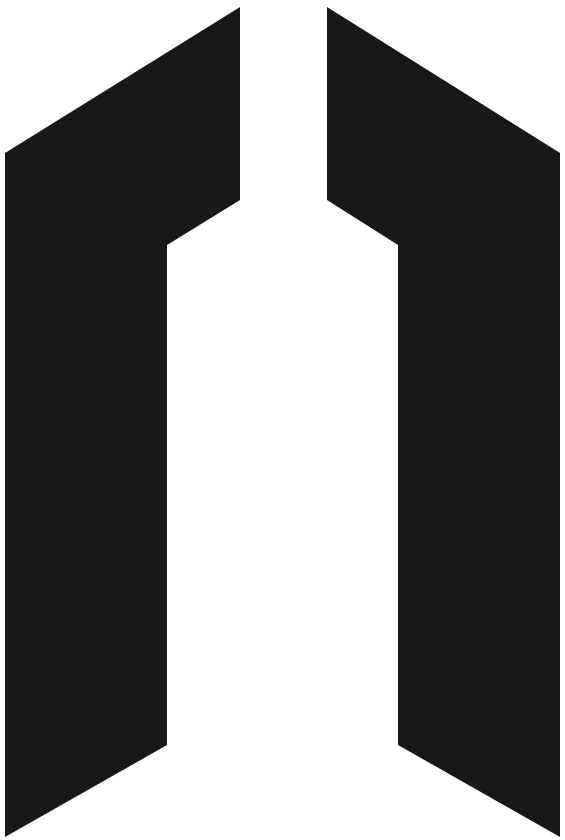
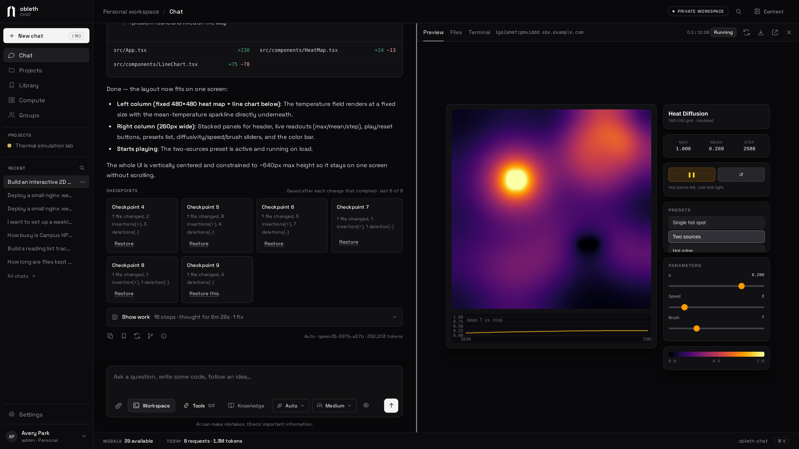
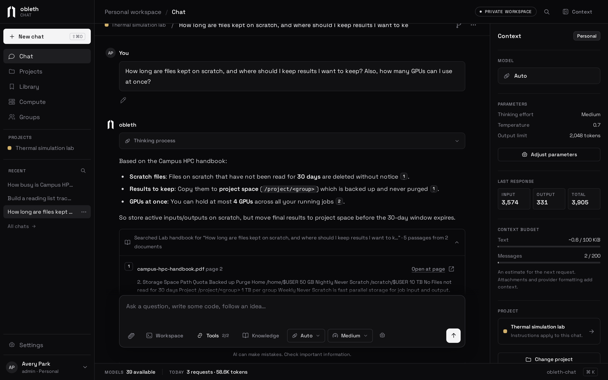
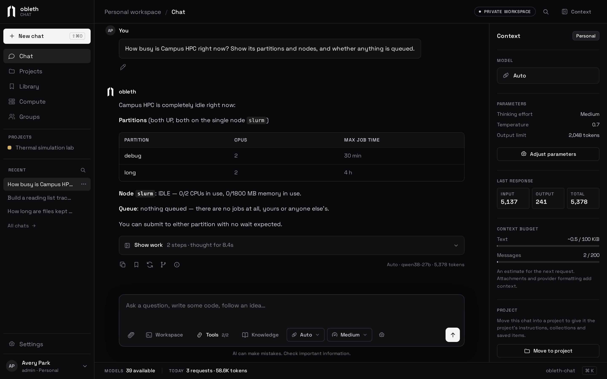
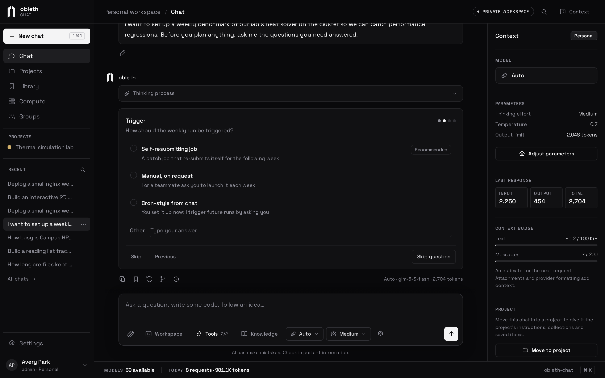
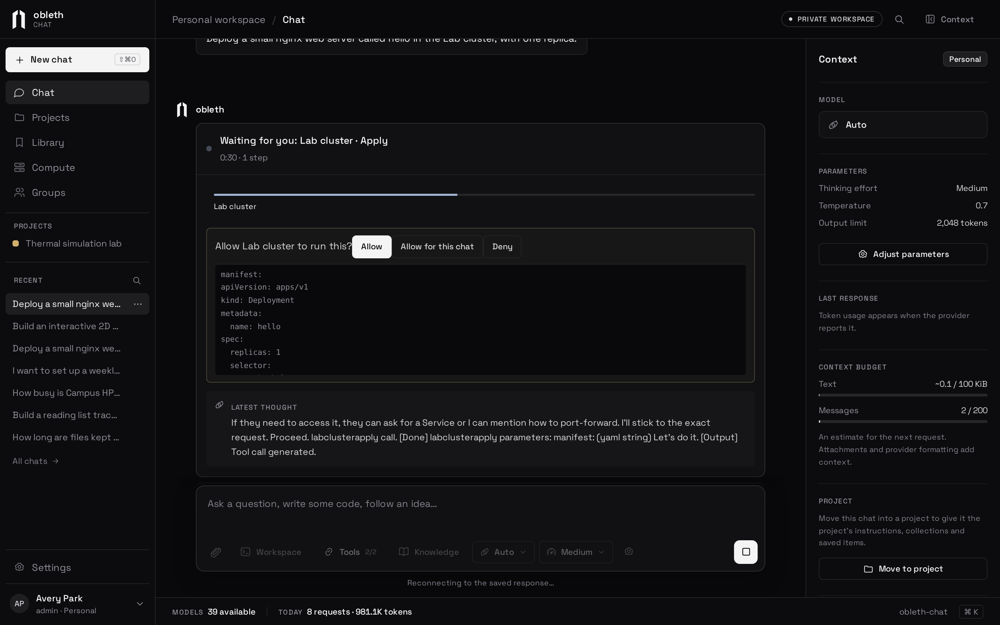
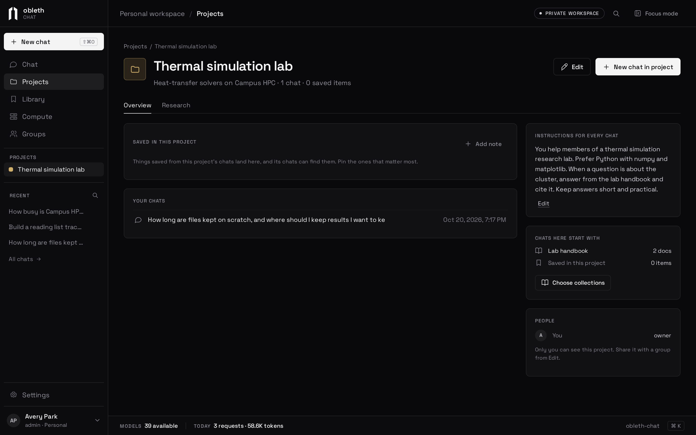
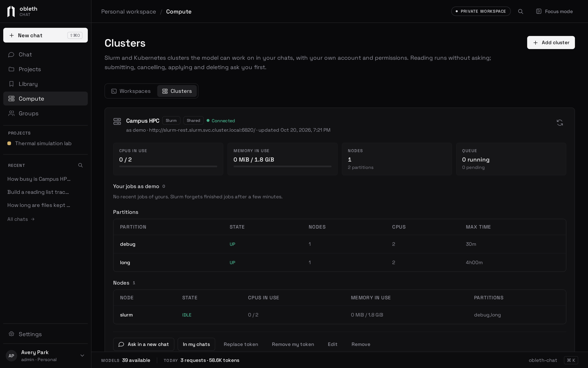

<p align="center">
  <picture>
    <source media="(prefers-color-scheme: dark)" srcset=".github/assets/logo-dark.svg">
    
  </picture>
</p>

<h1 align="center">obleth-chat</h1>

<p align="center">
  A self-hosted chat app for everyone who shares your models.<br>
  Private conversations, document search with citations, workspaces that build apps with a live preview,<br>
  project code with history, worker agents, and your Slurm and Kubernetes clusters as tools.
</p>

<p align="center">
  <a href="https://www.obleth.com/docs/chat/introduction"><b>Documentation</b></a> ·
  <a href="https://www.obleth.com/docs/run-chat/install">Install</a> ·
  <a href="https://www.obleth.com/docs/run-chat/connect-gateway">Connect the gateway</a> ·
  <a href="https://github.com/thediymaker/obleth-gateway">obleth gateway</a>
</p>

<p align="center">
  <a href="LICENSE"></a>
</p>

<p align="center">
  
</p>

---

obleth-chat runs on your own servers in front of [obleth](https://github.com/thediymaker/obleth-gateway), the fairshare gateway for self-hosted models. Each person signs in with their own account and their chats are stored in your Postgres. Every request reaches the gateway as that person, so fair share, budgets and usage apply per person, and nobody handles a shared API key.

## What it does

<table>
  <tr>
    <td width="50%" valign="top">
      <h3>Everyday chat</h3>
      Pick a model or <b>Auto</b>, set the thinking effort, attach files and images, edit or regenerate with versions you can step through, and share a chat read-only. Responses keep running on the server when you close the tab.
      <br><a href="https://www.obleth.com/docs/chat/conversations">Conversations →</a>
    </td>
    <td width="50%" valign="top">
      <h3>Knowledge</h3>
      Upload PDFs, Word files, HTML, Markdown and code into collections. Replies cite the passage they used, and each citation opens the source at that page.
      <br><a href="https://www.obleth.com/docs/chat/knowledge">Knowledge collections →</a>
    </td>
  </tr>
  <tr>
    <td width="50%" valign="top">
      <h3>Workspaces</h3>
      Describe an app and the model writes, runs and fixes it in a private Linux pod. The running app appears in a preview next to the chat, with files, a terminal and checkpoints.
      <br><a href="https://www.obleth.com/docs/chat/workspaces">Workspaces →</a>
    </td>
    <td width="50%" valign="top">
      <h3>Connections</h3>
      MCP servers, Slurm clusters and Kubernetes clusters become tools, acting as your own account. Anything that changes state waits for you to Allow or Deny it.
      <br><a href="https://www.obleth.com/docs/chat/connections">Connections →</a>
    </td>
  </tr>
  <tr>
    <td width="50%" valign="top">
      <h3>Projects and groups</h3>
      Give a set of chats shared instructions, documents and saved notes, and share the project with a group, such as a class.
      <br><a href="https://www.obleth.com/docs/chat/projects">Library, projects and groups →</a>
    </td>
    <td width="50%" valign="top">
      <h3>Research</h3>
      Run a tree of measured experiments: each idea is a git branch, every run uses the same command, and a chart tracks the best result.
      <br><a href="https://www.obleth.com/docs/chat/research">Research →</a>
    </td>
  </tr>
  <tr>
    <td width="50%" valign="top">
      <h3>Browser</h3>
      The model searches the web and reads pages in a real Chrome tab you watch beside the chat. Take over to sign in; it sees nothing until you hand back, and asks before submitting forms.
      <br><a href="https://www.obleth.com/docs/chat/browser">Browser →</a>
    </td>
    <td width="50%" valign="top">
      <h3>Any stack in a workspace</h3>
      Workspaces come with Node.js, Python with Jupyter and uv, Rust and Go. Any web server, from Flask or Streamlit to axum, shows in the preview.
      <br><a href="https://www.obleth.com/docs/chat/workspaces">Workspaces →</a>
    </td>
  </tr>
  <tr>
    <td width="50%" valign="top">
      <h3>Project code</h3>
      A project keeps one git history, synced from its chats' workspaces, with who changed each line. Compare versions, undo a commit, start a chat from any commit, and take the code out as a zip or to GitHub.
      <br><a href="https://www.obleth.com/docs/chat/project-code">Project code →</a>
    </td>
    <td width="50%" valign="top">
      <h3>Worker agents</h3>
      The model hands parts of a task to faster worker models that run at the same time, such as four explorers reading a codebase, and works from their reports.
      <br><a href="https://www.obleth.com/docs/chat/agents">Worker agents →</a>
    </td>
  </tr>
</table>

<table>
  <tr>
    <td width="50%"></td>
    <td width="50%"></td>
  </tr>
  <tr>
    <td align="center"><sub>Answers cite your documents, page by page</sub></td>
    <td align="center"><sub>Your clusters, as tools that act as you</sub></td>
  </tr>
  <tr>
    <td width="50%"></td>
    <td width="50%"></td>
  </tr>
  <tr>
    <td align="center"><sub>The model asks before it plans</sub></td>
    <td align="center"><sub>Nothing changes until you allow it</sub></td>
  </tr>
  <tr>
    <td width="50%"></td>
    <td width="50%"></td>
  </tr>
  <tr>
    <td align="center"><sub>Projects share instructions and documents</sub></td>
    <td align="center"><sub>Clusters, live, as your account sees them</sub></td>
  </tr>
</table>

Administrators publish models and choose who sees them, set generation defaults and daily allowances, manage accounts and groups, and can add OIDC sign-in.

## Quick start

With Docker or Podman, Chat brings its own PostgreSQL:

```bash
./setup.sh docker
```

On Kubernetes, with workspaces and each person's browser:

```bash
./setup.sh kubernetes
```

It asks for the address people will use and the gateway's URL, makes every password and key, starts Chat, and prints the administrator password and the entry that lets the gateway trust Chat. Workspaces run only on Kubernetes, and previews of the apps built in them need a wildcard DNS name and certificate. The [install guide](https://www.obleth.com/docs/run-chat/install) covers the options, the first sign-in and setting it up by hand.

To work on Chat itself, you need Rust stable and PostgreSQL 17 with [pgvector](https://github.com/pgvector/pgvector). Node.js 20.12+ is optional; it runs the wrapper that loads `.env`.

```bash
cp .env.example .env
# Set OBLETH_CHAT_DATABASE_URL, OBLETH_CHAT_ORIGIN and OBLETH_CHAT_BOOTSTRAP_PASSWORD
npm run start:api
# http://localhost:8085, sign in as admin
```

## Forwarding provider tokens

By default Chat signs its own short-lived token for each gateway call, and the gateway trusts Chat's issuer. With an OIDC provider that issues access tokens your gateway already accepts, Chat can instead send each person's own token, so the gateway sees the person rather than Chat and Chat holds no key that can act as anyone:

```bash
OBLETH_CHAT_OIDC_ISSUER=https://id.example.edu
OBLETH_CHAT_OIDC_CLIENT_ID=obleth-chat
OBLETH_CHAT_OIDC_CLIENT_SECRET=…
OBLETH_CHAT_OIDC_SCOPES="openid profile email offline_access"
OBLETH_CHAT_GATEWAY_AUTH=forward
OBLETH_CHAT_SECRET_KEY_FILE=/run/secrets/obleth-chat/secret_key   # openssl rand -hex 32
OBLETH_CHAT_SESSION_HOURS=2160
```

- The gateway must trust the provider: its issuer, its JWKS and the audience of its access tokens. Chat passes the token through unchanged.
- Chat keeps each sign-in's access and refresh tokens encrypted with the secret key, refreshes the access token shortly before it expires (one replica at a time), and sends it only in the gateway's `Authorization` header. MCP servers, workspaces, previews and the browser never see it.
- The provider decides how long a sign-in lasts. Once a sign-in's access token has expired, its next request refreshes it first; when the provider refuses (`invalid_grant`), Chat ends that sign-in and the API tokens made in it, whether or not the request would have reached the models. A provider that can't be reached is trusted for 15 minutes after the token expired, and is asked again for a sign-in at most every 30 seconds; an access token that has not expired yet keeps serving meanwhile, and signing out never waits on the provider. A refresh token sent with no answer back may have been rotated, and providers that rotate refresh tokens may take a late reuse as theft, so Chat presents it again only within 45 seconds of sending it and then ends the sign-in itself, as it does when a replica stops in the middle of a refresh. A refusal of Chat's own client (`invalid_client`) ends nothing: fix the client configuration. Signing out, revoking a session, disabling an account or a session expiring revokes the refresh token at the provider's `revocation_endpoint` when discovery lists one. Sessions that keep a grant are not capped by the ID token's expiry, so installs usually set long sessions such as 2160 hours; password sessions stay capped at 168 hours.
- Each sign-in uses its own grant, and an API token the grant of the sign-in it was made in, so ending one device's sign-in at the provider ends it in Chat. Auto mode and Knowledge indexing use the person's most recently refreshed sign-in. With none left they stop with "Sign in again to continue". An account can be linked to only one identity at the provider.
- People who sign in with a password use Chat's signed token if `OBLETH_CHAT_GATEWAY_SIGNING_KEY_FILE` is still set; without it they cannot reach the models. Someone linked to the provider never gets Chat's token.
- Accounts made at sign-in are named `oidc_` plus an id. If the provider assigns usernames itself and never reuses them (an institution's directory, not a provider where people pick their own), set `OBLETH_CHAT_OIDC_PROVIDER_USERNAMES=true`: accounts then take the provider's `preferred_username` when no other account has it, and keep following it on each sign-in. Names an administrator chose are never changed. A name can then pass from one account to another when the provider reassigns it, so anything downstream should identify people by Chat's user id or the provider's subject, not the username.
- To go provider-only, link existing administrators with **Link single sign-on**, then set `OBLETH_CHAT_PASSWORD_SIGN_IN=false` and remove the bootstrap password. Chat then offers only the provider's button.
- Set the secret key before removing the signing key: while both are set, saved connection tokens move to the secret key at startup and every five minutes after, which also catches tokens saved by replicas still running an older release during a rolling update. Those replicas can't open moved tokens until they are replaced. Remove the signing key only once every replica has the secret key and a few minutes have passed. Adding the secret key is one-way: a release or configuration without it can't read the moved tokens.
- `deploy/compose.connected.yaml` runs Chat with its own signed token and passwords on. Forward mode and `OBLETH_CHAT_PASSWORD_SIGN_IN=false` need a deployment that sets these variables and mounts the secret key, such as your own Kubernetes manifests.

## Branding and appearance

Edit [web/site.config.js](web/site.config.js) and reload the page. This public, commented configuration controls the site name and subtitle, assistant name, browser title and description, logo and favicon, greeting and assistant icons, the sign-in and home page text, the sign-in footer links, and an optional banner, such as a note that the service is in development, shown in the top bar of every page and above the sign-in page. You can also view the deployed file at `/site.config.js`. No build is needed when editing the served file; never put secrets in it.

- The logo and favicon default to the Obleth mark. To swap them, set `logo.light` and `logo.dark` (and `favicon`) to local image paths such as `./assets/custom/logo-light.svg`. One image works in both themes; leave both logo paths blank for a text-only brand.
- `links` lists the sign-in footer links as `{ label, url }`; use `[]` for none.
- Choose built-in icon names from [web/icons.js](web/icons.js), such as `chat`, `book`, or `sun`; set an icon to `''` to hide it.
- Text is plain text, with `\n` for a line break. Set optional text, including the sign-in and home page footers, to `''` to hide it.
- Set `appearance.defaultTheme` to `system`, `light`, or `dark`. People can switch appearance in the header or in Settings; their browser remembers their choice.

For Docker, copy the configuration and place your images in a host directory:

```bash
mkdir -p branding/assets
cp web/site.config.js branding/site.config.js
```

Add these mounts under the `obleth-chat` service in `deploy/compose.connected.yaml` (paths are relative to that Compose file):

```yaml
volumes:
  - ../branding/site.config.js:/app/web/site.config.js:ro
  - ../branding/assets:/app/web/assets/custom:ro
```

Recreate the container after adding the mounts. Subsequent branding edits only need a browser reload. Keep image URLs local to the app, for example `./assets/custom/logo-light.svg`; externally hosted images are not supported by the site's security policy. When serving a built `dist/` directory, edit its `site.config.js` and assets, or rebuild after editing `web/`.

## Repository

| Path | What's there |
| --- | --- |
| `api/` | The Rust server: auth, conversations, gateway streaming, Knowledge, workspaces, connections, research |
| `web/` | The browser app, plain JavaScript modules with no build step |
| `migrations/` | Postgres migrations, applied at startup |
| `deploy/` | Dockerfiles, Compose, the Kubernetes manifests, the workspace and browser images, Prometheus samples |
| `tests/` | Rust integration tests and Node unit tests |
| `server/` | A static design preview with sample data (`npm start`) |

## Development

```bash
npm test                       # web unit tests
cargo check --all-targets
# Rust tests need a disposable Postgres server; they create their own databases
DATABASE_URL=postgresql://… TEST_DATABASE_URL=postgresql://… cargo test --all-targets
```

## Credits

Space Grotesk is bundled under the SIL Open Font License (`web/assets/FONT-LICENSE.txt`). markdown-it and its dependencies are bundled with their notices in `web/vendor/markdown-it/`. Research mode follows the playbook of [OpenResearch](https://github.com/alphaXiv/OpenResearch) (MIT).

## License

[Business Source License 1.1](LICENSE). Source-available; each release converts to [Apache 2.0](https://www.apache.org/licenses/LICENSE-2.0) four years after publication.

**Free to run, including for other people.** A university can host obleth-chat for its students, faculty and researchers, and a company can host it for its employees. Recovering your costs inside your own organization (chargeback) is fine, and so is a free public instance with no ads. You can also charge for consulting, setup or support.

**Not free to sell.** Until the Change Date you may not charge others for access to obleth-chat: no paid hosted chat or AI workspace service built on it, whether through subscriptions, usage or per-token fees, credits, ads, or bundling it into a paid product. You also may not sell a competing product derived from it. The [LICENSE](LICENSE) has the exact terms. Contact the maintainers for a commercial license.
